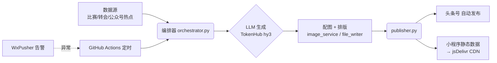
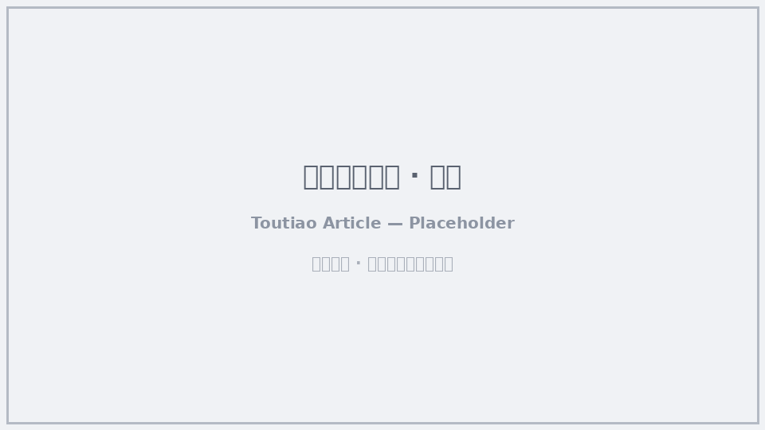
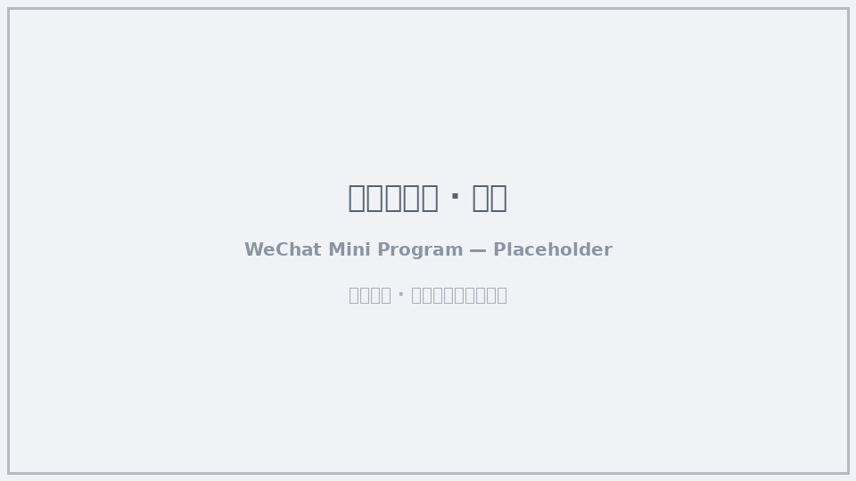

# 球评人老六 · 足球自媒体全自动内容工厂


> **一句话**：用 AI 把「选题 → 写稿 → 配图 → 发布 → 同步小程序」全包了。每天三班自动出稿，你只管看评论区吵架。

这是一个**完全无人值守**的足球自媒体内容生产系统：AI 自动追踪足球热点、生成带有固定人设「老六」的观点文章，自动发布到**今日头条（头条号）**，并同步到配套的**微信小程序**。整套流程由 GitHub Actions 定时驱动，零人工干预。

---

## 🌐 English Overview

**Lao Liu the Football Commentator** is a fully unattended, AI-driven content factory for a football (soccer) self-media brand. It automatically tracks football hotspots, generates opinionated articles in a fixed persona ("Lao Liu"), publishes them to **Toutiao (头条号)**, and syncs them to a companion **WeChat Mini Program** — all driven by GitHub Actions, zero manual work.

- 🤖 **AI writing** via a TokenHub / DeepSeek-compatible LLM (DashScope fallback), with a distinct persona per column.
- 🗓️ **Three daily batches** (Morning / Noon / Evening), 2 differentiated columns each — 6 unique pieces per day.
- 📡 **Dual-channel auto-publishing**: Toutiao (Playwright browser automation) + WeChat Mini Program (free jsDelivr CDN).
- 🛡️ **Production-grade**: idempotent re-publish guard, retry fallback, health checks & alerts (WxPusher).
- 💸 **Near-zero running cost**: free GitHub Actions + free CDN + cheap LLM.

Fork it, configure your Secrets, and you own your own football AI account. See the Chinese sections below for full details.

---

## 这是什么 / What is this

「球评人老六」是一个**足球垂类自媒体 IP 自动化引擎**。它解决的核心问题是：

> 做自媒体最贵的不是钱，是**持续产出有"人味"的内容**。一天三更、常年不断，人工写不现实，通用 AI 搬运又没灵魂、不带货。

本项目的做法是：给 AI 一个**固定人设 + 固定栏目**，让它像"一个人"一样每天稳定输出有态度、能引发站队互动的足球内容，并自动分发到多个平台。

**三个核心能力**
- 🤖 **AI 写稿**：基于 LLM（TokenHub / DeepSeek 兼容接口，通义千问兜底）生成文章，不是搬运，是"老六"的观点。
- 🗓️ **三班栏目制**：晨读 / 午间 / 晚间，每班 2 个差异化栏目，一天 6 篇不重样。
- 📡 **双端自动发布**：头条号（Playwright 浏览器自动化）+ 微信小程序（jsDelivr 免费 CDN 同步），一次生成多端触达。

---

## 为什么需要它 / Why

### 自媒体运营者的真实痛点
| 痛点 | 传统做法 | 本项目 |
|---|---|---|
| 日更三篇，写稿累死 | 雇人 / 自己硬写 | AI 全自动生成 |
| 内容没辨识度，涨粉难 | 搬运新闻，读者无感 | 固定人设「老六」，有态度有梗 |
| 多平台分发麻烦 | 手动复制粘贴 | 头条 + 小程序一次同步 |
| 断更有惩罚，请假就掉量 | 硬撑 / 花钱代运营 | 云端定时跑，节假日照样更 |
| 运维成本高 | 买服务器 | 白嫖 GitHub Actions + 免费 CDN |

### 本方案与众不同的地方
- **不是"AI 洗稿机"，是"AI 人"**：每个栏目有独立的写作人格（群聊播报体 / 烧烤摊辩论体 / 脱口秀吐槽体 / 赛后快刀体…），读者记住的是"老六"这个号，不是一堆冷冰冰的资讯。
- **栏目零重叠**：6 个栏目覆盖快讯、争议、战术、转会、辣评、球迷文化，互不抢戏，保证一天内容有节奏。
- **数据驱动选题**：结合真实比赛数据（football-data.org）、公众号热点抓取、维基/图库，避免 AI 瞎编。
- **工程级健壮性**：幂等防重发、多窗口重试兜底、健康巡检 + 告警，适合**长期无人值守**跑。

---

## 功能特性 / Features

- ✅ **每日三班自动生成**：晨读（08:00）、午间（12:00）、晚间（17:30 CST）。
- ✅ **动态条数（不再固定 2 篇）**：每批按当日高质量话题数动态生成，晨读/午间上限 4 篇、晚间上限 5 篇；素材少则少发，素材多则多发。
- ✅ **动态栏目池**：晚间从候选栏目中按当日热点智能挑选，内容不僵化。
- ✅ **多模型轮换 + 免费额度管理**：LLM 调用在 TokenHub 多模型池（hy3 / DeepSeek v4 / GLM-5 / Kimi / Hunyuan / MiniMax 等 20+ 模型）中按序轮换，单模型空响应/解析失败自动切下一个；每个模型免费额度用满前自动切换，避免产生实际费用（用量见 `data/llm_usage.json`）。
- ✅ **赛季感知选题**：新赛季（8/9 月「新赛季进行期」）多维覆盖赛程赛况、转会动态、球员八卦、比赛分析，避免单一维度堆砌。
- ✅ **多数据源融合**：
  - 比赛/转会数据：football-data.org
  - 热点发现：公众号爆款探测器（`skills/gzh-explosive-content-detector`）
  - 球员配图：Wikipedia / Footyrenders
  - 通用配图：Unsplash
- ✅ **自动发布双端**：头条号（浏览器自动化登录一次后长期复用）+ 微信小程序（静态 JSON 经 jsDelivr CDN 分发）。
- ✅ **幂等保护**：`metadata.json` 记录已完成批次，重跑不会重复发稿。
- ✅ **健康监控**：`heartbeat.yml` 午检/终检 + 爬虫健康检查，异常经 WxPusher 推送告警。
- ✅ **手动/补发通道**：`batch.yml` 支持 `workflow_dispatch` 手动触发与紧急补发（选 morning/noon/evening，可指定日期）。
- ✅ **配套小程序**：零成本微信小程序，自动同步当日文章，读者即点即读。

## 🧱 三层选题供给与计划落地模块 / Three-Tier Supply

> 实时抓取只能覆盖突发层，窗口期内事件密度不足即会断供。供给拆成三层互为缓冲，日更 6-8 篇稳定不断供。

- 🗓️ **一级·确定性（~30%，提前量产入库）**：赛程驱动由 `scripts/fixture_library.py` 生成选题池；转会窗截止日 / 赛季节点 / 开赛倒计时由 `config/season_calendar.yaml` + `deterministic_supply.py` 维护，`scripts/pregen_deterministic.py` 提前 7 天量产入库，发布日直接取用。
- ⚡ **二级·突发（~50%，当日实时装配）**：source 源文 → 物理隔离抽取 → 事实卡 → 改写（见下）。
- 🧊 **三级·软性（~20%，蓄水池补位）**：人物故事 / 榜单 / 数据对比 / 历史回顾无时效压力，`reservoir.py` 库存 + `scripts/refill_reservoir.py` 备货，突发日补位、密集日顺延。
- 📏 **供给占比落实与验收（计划 12.1）**：`supply_mix.py` 给每篇成稿打三级分层标签（`_supply_layer`），`scripts/verify_supply_mix.py` 校验三层齐备与配比偏差（目标 30/50/20，容差 ±15pt）并产出逐日构成报告。
- 🧾 **赛程落库与接口额度台账（计划 11.4）**：每日批量拉取**未来 14 天**赛程写库（football-data 免费层单次窗口上限 10 天，自动分块），业务侧只读 `data/fixtures/topic_pool.json`；所有外部调用过 `api_budget.py` 台账（按源按日计数，双闸门：单源额度 + 全局 **3 次/日**），超限即拒绝并降级、绝不阻塞。补源联赛按日 4 日轮换，非轮换日只读最近缓存（`api_football.read_cache`），额度可经 `config/api_budget.yaml` 或环境变量覆盖。

### 反洗稿与合规（计划 4 / 11.3）

- 🔒 **物理隔离**：抽取器把源文压成结构化事实三元组，生成器物理看不到原文；`assert_no_verbatim` 硬闸门（连续 ≥12 字逐字重合即失效）。
- 📐 **相似度闸门**：连续重合 >12 字 或 8-gram 重合率 >15% 判洗稿；信息增量要求事实点数 ≥ 最强源文且新增 ≥2。
- 🧾 **事实卡**：8 字段 + 三级可信度 + 生命周期（进行中 / 已收官 / 已过期），落 `data/facts/`。
- 🧯 **合规红线熔断**：`compliance_guard.py` —— 不实内容级违规出现一次即暂停自动发布，同批次一致性打回 ≥5 次自动熔断，跨运行持久化到 `data/compliance_state.json`（**刻意纳入版本控制**：否则下一次 CI 跑仍是「未熔断」，红线形同虚设）。熔断时写入 `evidence`（最近 8 次打回的具体选题与问题），避免事后只看到最后一条提示而无法定位触发批次。
- 🏷️ **队名别名感知判定**：`orchestrator._team_forms/_team_in_content/_teams_in_content` —— 事实校验要求「同一支球队」而非「同一个字符串」：规范名、entity_map 别名（拜仁 / 拜仁慕尼黑）与 TEAM_ALIASES 同组写法互认，并按**最长匹配**消除子串串味（正文「国际米兰」不再被当成卡外球队「米兰」）。2026-10-12 的自动熔断即由「字面包含」误报引起，此法为其根因修复。
- 🧿 **高风险队列**：伤病 / 合同金额 / 争议指控类事实进 `risk_gate.py` 人工复核队列。
- 🖼️ **封面绑定**：`cover_binding.py` 强制图片客体与标题实体绑定，删除通用兜底图。
- 🎯 **择优模型（L1→L4）**：`ranker.py` 规则预筛 → 信号增强 → 五维量表（可走 LLM 打分）→ 缓存降级；无信号 / 模型不可用时自动降级规则排序。L1 预筛统一走认知度门槛。
- 🗣️ **传闻分级措辞系统（计划 4.1 / 3.2）**：`rumor_wording.py` —— 事实卡三级可信度对应三种措辞：已确认可用陈述句、单源须写「据某媒体报道」、传闻须写「传闻 / 有消息称」；**传闻类标题禁用肯定语气**（官宣 / 确定 / 敲定 / 达成 / 确认 / 签下…），命中即标题 0 分打回（对冲「严重标题党扣 30 分」）。分级未携带时不判定、绝不误杀；多处分级取最弱（取严不取宽）。
- 📡 **信源与热度信号**：`source_watch.py`（11 个信源清单）+ `signal_sources.py`（百度热搜→社媒讨论量、百度联想→搜索指数）；只对真实命中写入，未命中即标缺失，**绝不用 0 冒充**。
- 🌏 **洲际赛程**：`api_football.py` 补亚冠 / 欧联 / 欧协联 / 中超（联赛 ID 动态解析、不硬编码），缓存跨日有效并受额度台账管控。
- 🈶 **中文实体映射与认知度硬门槛（计划 13.1）**：`config/entity_map.json`（`scripts/build_player_map.py` / `scripts/build_team_map.py` 增量维护）+ `awareness_gate.py` —— A 可进新闻流 / B 需配认知锚点或改走故事角度 / C 降权或只进数据类与榜单类 / **未登记实体一律拒绝**（不再与 C 级混同）；C 级 confidence=low 不参与标题生成。新闻流（news）与数据榜单（data_list）两条通道动作不同。
- 📉 **失败降级**：`degrade.py` 六路径策略表；一致性打回 → 降级低风险板块重生成一次，仍不过即丢弃。
- 📚 **内容参照层（计划 13.3）**：`config/content_reference.yaml` + `content_reference.py` —— 只借方法论（信源标注规范 / 标题信息结构 / 话题时效判断 / 栏目化与内容分层）与五家媒体侧重；**排除项**（中下游球队转会细节 / 欧战赛前前瞻 / 二线联赛赛事稿 / 三千字深度长文）由 `ranker` L1 预筛与生成提示**双向拦截**。仅在标题/话题标签层保守匹配，未命中即放行（绝不误杀）。
- ✨ **六个差异化方向（计划 13.5）**：`config/differentiation.yaml` + `differentiation.py` —— 速度 / 地域深耕 / 怀旧与情感 / 数据再加工 / 评论区运营 / 观点增量，逐方向核对代码 hook 落地。

### 验收与审计（计划 4.1 / 6.1 / 6.2 / 7.1 / 7.2 / 7.3 / 8.1 / 10 / 11.3 / 11.4 / 11.5 / 12.1 / 12.2 / 12.4 / 13.1 / 13.2 / 13.3 / 13.4 / 13.5）

- 📊 **验收指标看板**：`scripts/build_metrics_dashboard.py` —— 合规红线区 + 增长指标（篇均阅读 / 点击率 / 完成率 / 粉丝阅读占比 / 涨粉，对照 30/90 天目标）+ 供给区；未接入指标标注「待接入」。
- ⬆️ **增长指标回填**：`scripts/import_performance.py` 支持 CSV/JSON 批量回填头条后台数据（点击率 = 阅读/展现，粉丝阅读占比 = 粉丝阅读/总阅读）。
- 🔍 **隔离常态化审计**：`scripts/audit_isolation.py` —— 模板隔离 / 生成路径静态隔离 / 同天成稿重复自查 / 溯源覆盖率。
- ✅ **赛程池验收**：`scripts/verify_fixture_pool.py` —— 五类覆盖 / 单日候选 ≥6 / 前瞻体为 0（硬项）+ 板块配比偏差（告警项）。
- 📏 **供给分层验收**：`scripts/verify_supply_mix.py` —— 分层合法性 / 无断供日（硬项）+ 三层配比偏差与未分层成稿（告警项）。
- 🧾 **接口额度验收**：`scripts/verify_api_budget.py` —— 台账无超限日 / 14 天窗口落库（硬项）+ 业务侧不直连赛程接口 / 各源缓存新鲜度（告警项）。
- 🈶 **认知度门槛验收**：`scripts/verify_awareness_gate.py` —— 16 条规则用例自检 / 映射表 awareness 与 confidence 合法性 / 供给物零违规（硬项）。
- 🗣️ **传闻措辞验收**：`scripts/verify_rumor_wording.py` —— 13 条规则用例自检 / 分级常量与 `fact_card` 同源 / 成稿标题零「传闻当官宣」（硬项）。
- 📚 **内容参照层验收**：`scripts/verify_content_reference.py` —— 排除项规则自检 / 参照层配置完整性 / `ranker` 与生成提示接入（硬项）+ 历史产物零命中排除项（告警项）。
- 🚦 **发布闸门验收（计划 7.2 / 7.3）**：`scripts/verify_publish_gate.py` —— 成稿标题零硬违规 / **队名判定别名感知**（同义写法放行、真缺队名与卡外球队拦截）/ 一致性拦截率可统计 / 连续 14 天无旧闻新发（硬项）+ 标题合规率、溯源覆盖率、误杀率、**打回可追溯**（告警项，无标注标「待接入」绝不冒充 0）。台账由 `freshness_ledger.py`（时效闸门）与 `consistency_stats.py`（一致性校验，打回事件带选题标题）落 `data/`。
- ✨ **差异化方向验收**：`scripts/verify_differentiation.py` —— 六方向结构齐备 + 代码 hook 落地（硬项）。
- 🎛️ **调参纪律与四道防呆验收（计划 8.1 / 11.5）**：`scripts/verify_tuning_discipline.py` —— 六项纪律数值落在计划区间 / 四道防呆代码执行点齐备 / 用 `ratio_tuner.compute_suggestion` 实跑冒烟（样本冻结、死区、幅度≤10 + 探索配额托底、冷静期）（硬项）。
- 🧱 **事实层与量表验收（计划 6.1 / 6.2 / 12.2 / 12.4）**：`scripts/verify_fact_layer.py` —— 事实卡八字段 / 可信度三级阈值 / 生命周期三态边界（进行中·已收官·已过期）/ 择优五维量表齐备（硬项）。
- 🗂️ **数据源与信源清单验收（计划 13.2 / 13.4）**：`scripts/verify_source_roster.py` —— 四源分工齐备 / 原始信源清单 11 项齐备 / 信源只作信号（硬项）+ 不接入商业数据商、无授权媒体边界（告警项）。
- 📈 **验收指标与合规熔断验收（计划第十章）**：`scripts/verify_acceptance_metrics.py` —— 不实违规即熔断且可解除 / 疑似系统性失真达阈值自动熔断 / 六项指标口径与计划一致 / 未接入一律「待接入」绝不用 0 冒充（硬项，用隔离状态文件不污染真实熔断开关）。

> 全部验收脚本产出 `data/audit/*_latest.json` + 日期报告，硬项 FAIL 退出码 1；接入 CI 时统一「只告警不阻断发布」（计划九），保证当天少发而非全空。

## 内容治理与防限流机制 / Content Governance

> 针对头条号「同质化限流、CTR 偏低、涨粉乏力」做的工程化改造。完整诊断与改造成品见 [`docs/头条号数据体检与改造诊断报告.md`](docs/头条号数据体检与改造诊断报告.md)。

- 🛡️ **语义去重（事件指纹）**：同一场比赛（同两队 + 同比分）近 7 天只发一次，与措辞无关；含球队别名归一化（马竞 = 马德里竞技），转会/八卦等无比分内容不误杀。
- 🚫 **去模板化**：禁止所有选题/标题使用固定栏目前缀（如「老六精准预测：」），近 7 天标题开头不重样，杜绝每天复读同一口号。
- 💡 **强制信息增量**：每篇须自带 ≥2 个「他处未见」的信息点，否则有低创作价值限流风险。
- 🎯 **标题强钩子**：疑问/悬念类占比 ≥60%、反差/冲突类 ≥30%，严控平铺直叙陈述句，提点击率。
- ⚖️ **内容类型再平衡**：按赛季动态引导球评下限 / 转会八卦上限，避免单一品类霸屏（不改 `config.yaml` 权重，仅在 prompt 层引导 + 非阻断监控）。
- 🎙️ **调性向 41+ 男球迷对齐**：多用情怀 / 通俗战术 / 国足记忆，少堆年轻网感梗。
- 🔗 **粉丝沉淀钩子**：每篇自然植入「关注 / 追更」引导，攒粉丝。
- 🏷️ **垂直栏目锚点**：按内容类型补齐栏目 / 风格 / 互动字段，强化算法垂直识别，消除元数据空字段。
- 📊 **非阻断监控**：标题钩子分布、内容类型分布、信息增量、共鸣角度覆盖、系列连载分布均做运行期告警（不阻拦发布），便于 dashboard 闭环复盘。

---

## 🎭 品牌手册与人设引擎 / Brand Manual & Persona Engine

> 把「球评人老六」的人设、口吻、立场、红线、栏目、共鸣剧本、系列剧本集中维护在 [`config/brand_manual.yaml`](config/brand_manual.yaml)，作为**单一事实源**注入选题与改写 prompt——改人设 / 栏目 / 共鸣 / 连载只动这一个 YAML，根治 AI 偷懒与无魂。

- 🎭 **品牌手册（单一事实源）**：人设 / 口吻禁用词 / 固定立场 / 41+ 男球迷情绪基调 / 硬·软红线 / 五栏目定义与风格，集中维护并自动注入两个 prompt；改写风格引导（`style_guide`）亦由栏目定义派生。
- 💞 **情绪共鸣剧本**：国足情结 / 老球迷身份认同 / 世界杯经典时刻 / 名帅名宿沉浮四角度（含 triggers + framing 示例），选题须标注 `resonance_angle`、改写自然织入，配「共鸣角度覆盖」非阻断监控。
- 📚 **连载栏目引擎**：国足编年史 / 世界杯名局考古 / 老球迷夜话三系列，选题标注 `series_id`、改写注入追更引导，配「系列连载分布」非阻断监控；同批 ≤1 系列，且受去重（P0-1）与类型平衡（P1-6）约束，不劣化防限流成果。

---

## 🎬 数字人口播视频管线 / Video Pipeline（Phase 0+1 · 免费 MVP）

> ⏸️ **状态：暂停使用（2026-09-27）** —— 实测效果未达预期，暂不接入发布链路。
> 本节及 `video_pipeline/` 相关代码**保持入库留档**，但**不参与任何定时发布流程**
> （`batch.yml` 不调用）。图文发布链路不受其影响，可放心忽略本模块。
> 后续若重启，再单独评估。

> 把同一篇图文**额外**产出「数字人口播视频」，发头条号 / 抖音 / 视频号。**独立于现有图文发布链路**，复用品牌手册与 LLM 额度，零新增成本、本地 CPU 可跑、无 GPU。

- 📝 **口播稿**：`video_pipeline/script_gen.py` 复用 `config/brand_manual.yaml` + LLM，产出 60–90s 口语稿（黄金 3 秒强钩子 + 共鸣/系列钩子 + 结尾互动钩子）；LLM 失效自动回退规则兜底，**绝不阻断生成**。
- 🔊 **TTS**：`video_pipeline/tts.py` 默认 **Edge TTS 云希（男声，免 key）**，云健/晓睿降级备选；句级时间轴直接喂 `SubMaker` 出 SRT。声线克隆（GPT-SoVITS）/ 火山引擎分支已预留开关，默认关。
- 🎞️ **合成**：`video_pipeline/compose.py` 用 ffmpeg 把**肖像（老六本人照）+ Ken-Burns 推拉 + 音频 + 烧录字幕** → 1080×1920 竖屏 mp4；无肖像时自动用渐变背景兜底。编码器自动择优选 H.264（libx264 / libopenh264）。
- 🧩 **编排**：`video_pipeline/pipeline.py` 串起「稿→音→字幕→视频→元数据」，命令行 `--demo` / `--article <json>` 即跑。

```bash
# 装依赖（生成侧）
pip install edge-tts            # 免 key 中文男声 TTS
# 跑一遍内置样例（无需 API key 也能验证 ffmpeg 链路；TTS 需联网微软）
python video_pipeline/pipeline.py --demo
# 指定文章 JSON（含 title/content，可选 resonance_angle/series_id/source_id）
python video_pipeline/pipeline.py --article my_article.json
```

产出落在 `output/videos/YYYY-MM-DD/`（mp4 + srt + wav + meta.json）。**发布侧本期手动**：头条号跑通后，抖音/视频号由你手动上传（符合「其他平台我自己传」约定）；头条视频自动发布作为下一批验证。

---

## 它是怎么跑起来的 / How it works



每日流程（由 Cloudflare Worker 主调度在 CST 08:00/12:00/17:30 触发 workflow_dispatch，GitHub Actions `batch.yml` 原生 cron 仅在其失效时兜底）：

1. **确定批次**：根据当前 CST 时段判定 morning / noon / evening。
2. **选题**：LLM 多模型轮换按栏目规则 + 数据源打分，选出当日话题与角度（新赛季自动偏向赛程/转会/八卦/分析多维覆盖）。
3. **生成**：LLM 按栏目人设写稿（带互动投票/站队引导）；改写与赛前预测同样走多模型轮换，单模型空响应自动切换。
4. **配图排版**：抓取球员图/通用图，渲染 Markdown。
5. **发布**：头条号浏览器自动化发文；同步小程序静态数据。
6. **巡检**：心跳工作流核对批次完成情况，缺失则告警。

---

## 技术栈

| 层 | 技术 |
|---|---|
| 语言 | Python 3 |
| LLM | TokenHub 多模型池（hy3 / DeepSeek v4 / GLM-5 / Kimi / Hunyuan / MiniMax 等 20+ 模型，按序轮换）；通义千问 DashScope qwen-turbo 兜底；免费额度用满前自动切换 |
| 数据 | football-data.org、公众号抓取、Wikipedia API、Unsplash、Footyrenders |
| 自动化 | GitHub Actions（`batch.yml` / `heartbeat.yml`）+ Cloudflare Worker（主调度） |
| 浏览器 | Playwright（头条号发布） |
| 前端 | 微信小程序 + jsDelivr CDN |
| 通知 | WxPusher |

---

## 快速开始 / 自己搭一个

> 想拥有**你自己的**足球 AI 号？Fork 本项目，配好 Secrets，剩下的交给 GitHub。

### 1. Fork & 启用 Actions
- Fork 到你的账号，**公开仓库可白嫖 GitHub Actions 额度**。
- 进入 `Settings → Actions → General`，确认 `Allow all actions` 已开启。

### 2. 配置 Secrets（`Settings → Secrets and variables → Actions`）

| Secret | 必需 | 说明 |
|---|---|---|
| `HY3_API_KEY` | ✅ | TokenHub / DeepSeek 兼容 LLM Key（**只在 Secrets 里，永不进代码**） |
| `TOUTIAO_AUTH_B64` / `TOUTIAO_AUTH_GZ` | ✅（发头条） | 头条号 Playwright 登录态（base64）。本地先 `python scripts/publisher.py --login` 登录，把 `toutiao_auth.json` 内容 base64 后存入 |
| `GH_PAT` | ✅（同步小程序） | 用于回写小程序静态数据的 Personal Access Token |
| `WXPUSHER_APPTOKEN` / `WXPUSHER_UID` | ⚠️ 推荐 | 运行告警推送 |
| `FOOTBALL_DATA_KEY` | ⚠️ | football-data.org 比赛数据（增强选题） |
| `DASHSCOPE_API_KEY` | ⚠️ | 兜底 LLM |
| `UNSPLASH_ACCESS_KEY` | ⚠️ | 通用配图 |

### 3. 本地首次登录头条号
```bash
pip install -r requirements.txt
python scripts/publisher.py --login      # 浏览器打开手动扫码登录，自动保存状态
# 将生成的 toutiao_auth.json 内容 base64 编码后填入上方 Secret
```

### 4. 让它自己跑
- 定时：GitHub Actions 按 CST 三班 cron 自动触发。
- 手动：在 Actions 页面对 `足球自媒体每日发布（手动/外部触发）` 点 `Run workflow`，可选 `batch=morning/noon/evening` 补发。

### 5.（可选）配套小程序
`miniprogram/` 是一个零成本微信小程序，构建后静态数据经 jsDelivr CDN 分发。按 `miniprogram/README.md` 注册、加 CDN 白名单、上传审核即可。

---

## 项目结构

```
football-auto-publish/
├── orchestrator.py          # 文章生成编排器（选题→生成→配图→排版）
├── publisher.py             # 头条号 Playwright 自动发布 + 小程序数据回写
├── data_collector.py        # 比赛/转会/热点数据采集 + 一级·确定性赛程选题
├── media_scraper.py         # 媒体素材抓取
├── image_service.py         # 配图服务
├── match_scheduler.py       # 赛程调度
├── extractor.py             # 物理隔离：源文 → 结构化事实（生成器看不到原文）
├── fact_card.py             # 事实卡编译/持久化/生命周期（三级可信度）
├── rumor_wording.py         # 传闻分级措辞 + 传闻标题硬校验（禁肯定语气）
├── awareness_gate.py        # 认知度分级硬门槛（A/B/C/未登记；news 与 data_list 双通道）
├── content_reference.py     # 内容参照层（13.3：只抄方法论，排除项拦截）
├── differentiation.py       # 六个差异化方向（13.5：方向与代码 hook 核对）
├── freshness_ledger.py      # 时效闸门台账（7.2：连续无旧闻新发可审计）
├── consistency_stats.py     # 一致性校验台账（7.3：拦截率 / 误杀率）
├── supply_mix.py            # 三级供给分层打标与配比校验（30/50/20）
├── api_budget.py            # 外部接口每日额度台账（按源按日计数 + 全局 3 次/日闸门）
├── ranker.py                # 择优模型 L1→L4（含 LLM 打分与降级）
├── source_watch.py          # 信源清单与热度信号（信源前移）
├── signal_sources.py        # 社媒/搜索公开信号采集（百度热搜/联想）
├── risk_gate.py             # 高风险事实人工复核队列
├── cover_binding.py         # 封面与标题实体绑定
├── reservoir.py             # 三级·软性内容蓄水池
├── deterministic_supply.py  # 一级·确定性节点供给（转会窗/赛季节点/倒计时）
├── degrade.py               # 失败降级策略表
├── compliance_guard.py      # 合规红线熔断（不实违规即暂停自动发布）
├── api_football.py          # 洲际赛程源（亚冠/欧联/欧协联/中超）
├── constants.py             # 批次/栏目配置、人格与写作风格定义
├── config/config.yaml       # LLM、数据源、输出配置
├── config/season_calendar.yaml  # 赛季节点日历（一级确定性供给）
├── config/entity_map.json   # 中文实体映射（球队/球员，人工译名 + 认知度分级）
├── config/ratio_config.yaml # 板块配比与调参纪律
├── config/api_budget.yaml   # 外部接口每日额度（单源 + 全局 3 次/日，可覆盖）
├── config/content_reference.yaml # 内容参照层（参照项 / 排除项 / 五家媒体）
├── config/differentiation.yaml   # 六个差异化方向（13.5）
├── prompts/                 # 选题/改写提示词模板
├── skills/                  # 公众号爆款探测器
├── scripts/                 # 巡检、补发、告警、静态数据导出、看板/审计/维护等
├── miniprogram/             # 配套微信小程序
├── tests/                   # 单元测试
└── .github/workflows/       # batch / daily / heartbeat / 审计 / 看板 / 维护等
```

---

## 调度与健康监控

- **`batch.yml`**：每日三班**唯一发布管道**。「单一兜底」调度——Cloudflare Worker 在 CST 08:00/12:00/17:30 准点触发，本文件原生 cron 仅在主调度失效时兜底（晚 30 分钟，幂等保护不重复发稿）。手动/补发也走此文件的 `workflow_dispatch`。发布前依次执行：合规熔断检查 → 刷新赛程选题池（14 天窗口，接 football-data / juhe / API-Football 三源）+ 7.1 验收 + **11.4 接口额度验收** → 一级节点量产入库 → 三级蓄水池备货；生成后追加 **4.1 传闻措辞验收** + **7.2/7.3 发布闸门验收**，并跑 **13.3 内容参照层验收** 与 **13.5 差异化方向验收**。全部验收「只告警不阻断」，产物落 `data/audit/`。`data/fixtures` 通过 Actions 缓存跨运行保留——赛程库是「库」而非一次性产物，否则每次运行都是冷启动、额度必被联赛 ID 解析吃掉。
- **`heartbeat.yml`**：午检（仅校验晨读是否完成，避免未到点误报）+ 终检（校验三班全完成），异常经 WxPusher 告警。
- **`refresh-signals.yml`**：每日 06:30 CST 预热社媒/搜索热度信号（早于早批），产出 `data/signals/external_signals.json`。
- **`isolation-audit.yml`**：每周日跑物理隔离常态化审计，产出 `data/audit/`。
- **`fixture-pool-verify.yml`**：每周一刷新赛程池并跑 7.1 验收，硬项不过即失败告警。
- **`metrics-dashboard.yml`**：每周一生成验收指标看板，回写 `data/metrics/`。
- **`ratio-tuner.yml`**：每月 1/15 日跑配比调参（四道防呆）。
- **`plan-invariants-verify.yml`**：每周一跑计划结构不变量验收（8.1/11.5 调参防呆、6.1/6.2/12.2/12.4 事实层与量表、13.2/13.4 数据源与信源、第十章验收指标与合规熔断），只告警不阻断，报告回写 `data/audit/`。
- **`entity-map-refresh.yml`**：每月 1 日增量维护中文实体映射（球队/球员）。

---

## 成本 / 费用

| 项目 | 费用 |
|---|---|
| GitHub Actions 运行 | 公开仓库免费额度内基本为 0 |
| 小程序静态托管（jsDelivr CDN） | 免费 |
| LLM 调用 | 0 元：多模型免费额度按序轮换，用满前自动切换，几乎不触发付费 |
| 数据 API（football-data 等） | 免费档或按需 |
| 头条号 / 小程序 | 平台免费 |

**整体接近"零运维成本"的自媒体内容生产线。**

---

## 为什么选这个方案（写在最后）

如果你也在做或想做**足球垂类自媒体**，这个方案值得 fork 的理由：

1. **真·无人值守**：从选题到发布全链路自动化，断更焦虑归零。
2. **有 IP 才有价值**：固定人设「老六」输出观点，沉淀的是**粉丝与互动**，而不是一次性阅读——这对涨粉和后续变现才是关键。
3. **成本几乎为零**：白嫖 CI + 免费 CDN + 多模型免费额度轮换的 LLM，一个人就能养一个"日更三篇"的号。
4. **工程上能长期跑**：幂等防重、重试兜底、健康巡检、告警——这些"看不见的活"决定了一个自动化项目是跑三天还是跑三年。
5. **可演进**：栏目、人格、数据源都在 `constants.py` / `config.yaml` / `prompts/` 里集中配置，想换风格、加栏目、接新平台都很容易。

> 拿去改、拿去用、拿去养你自己的"老六"。欢迎 Issue 与 PR。

---

## 📸 截图 / Screenshots

> 下方为占位图，请用你自己的**头条号文章页**与**微信小程序界面**真实截图替换 `docs/screenshots/` 下的文件（建议 PNG，宽 ≥ 800px）。

| 渠道 | 预览 |
|---|---|
| 头条号（头条号）已发布文章页 |  |
| 配套微信小程序文章阅读页 |  |

**建议截图内容**
- `toutiao-article.png`：一篇已发布的「老六」风格文章，含标题、正文、互动投票/站队引导。
- `miniprogram.png`：小程序内文章列表或详情页。

---

## 免责声明

- 本仓库内容由 AI 自动生成，**不代表任何真实立场**，文中观点均为"老六"人设演绎，请勿对号入座。
- 请遵守各内容平台（今日头条、微信等）的运营规范与社区公约，合规使用。
- 使用本项目产生的任何内容、账号风险与费用，均由使用者自行承担。
- 与任何足球俱乐部、球员、联赛无官方关联。
